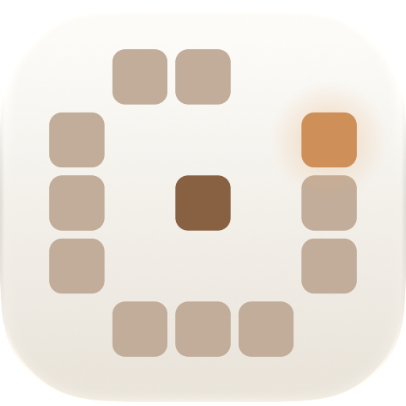
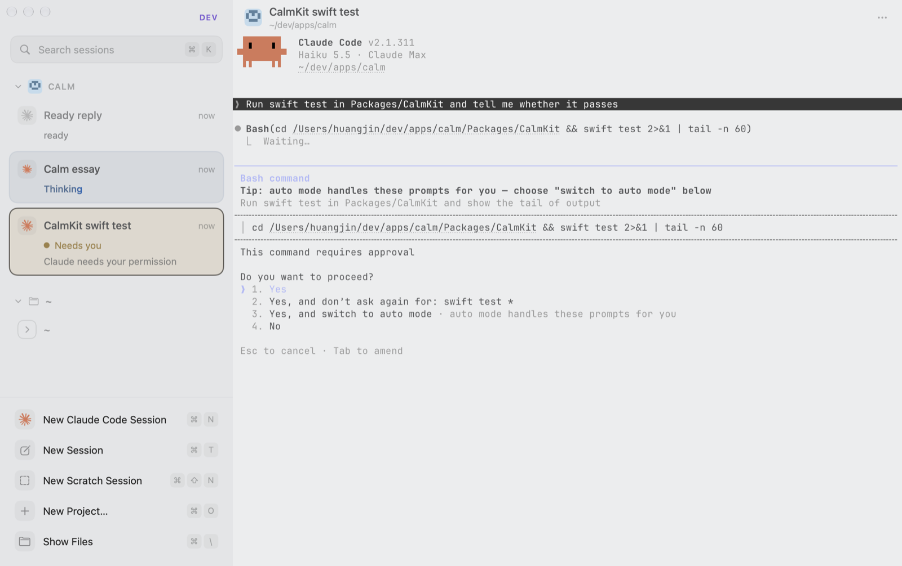
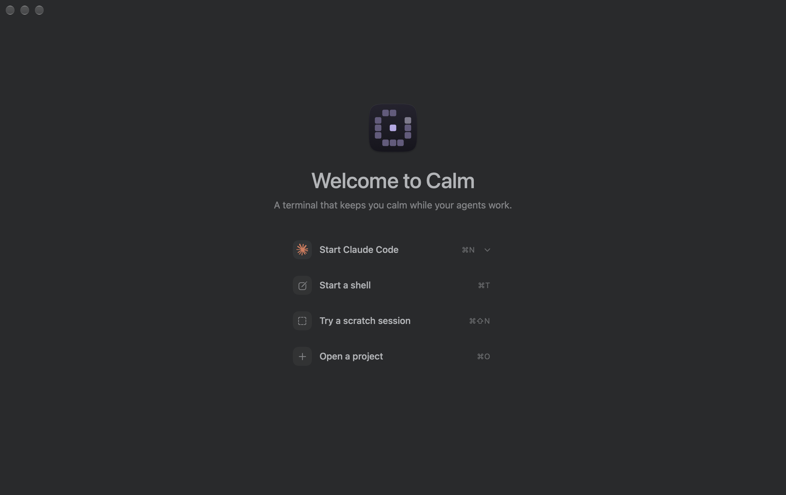
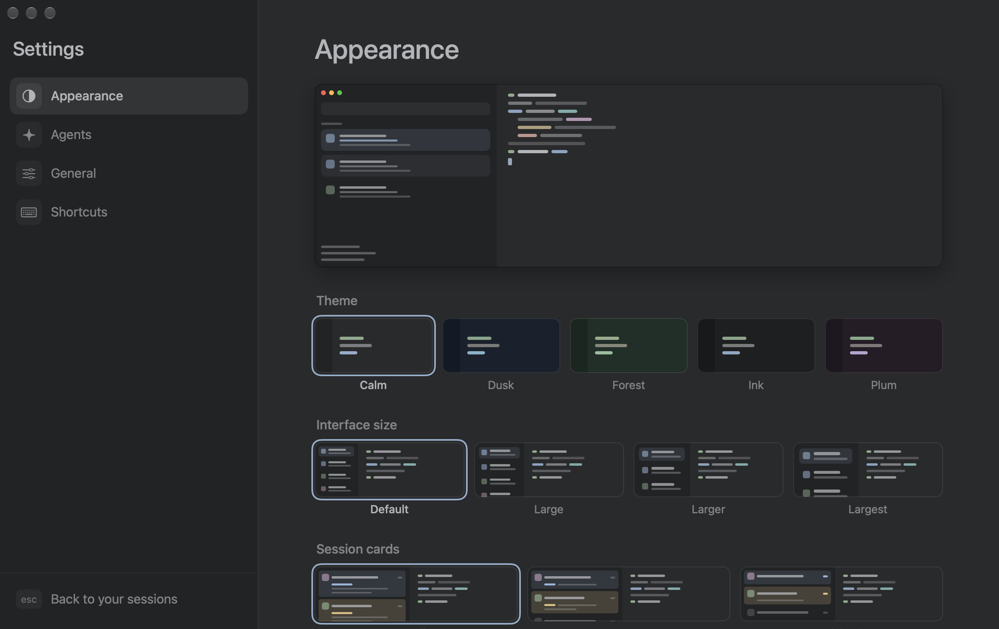

<!-- what-we-build: drafted 2026-10-28 -->

<div align="center">

<picture>
  <source media="(prefers-color-scheme: dark)" srcset="assets/logo-dark.png">
  
</picture>

# Calm Terminal

> A minimal macOS terminal that keeps you calm and focused.

[](https://github.com/jinhuang712/calm/actions/workflows/ci.yml)
[](LICENSE)


<br>

<picture>
  <source media="(prefers-color-scheme: dark)" srcset="assets/hero-dark.png">
  
</picture>

</div>

Calm is a terminal for days spent supervising CLI coding agents such as Claude Code, Codex, OpenCode and pi. It interrupts you for one thing only: an agent that needs you. Calm stays a terminal, so the agents keep their own interfaces.

> [!NOTE]
> Version [0.1.4](CHANGELOG.md), a public preview. Only the author has used it, since 2026-09-29, so expect rough edges (see Known limits below).

## ✨ What it is

- 🔔 **Shows which session needs you.** The sidebar shows whether each agent is working, needs you, is done or has failed. Only *needs you* sends a notification, at the next natural pause.
- 💾 **Keeps sessions alive.** Quit Calm and your shells keep running. On relaunch every session, split and running agent returns.
- 🚀 **Starts your agent with one key.** ⌘N opens a session with Claude Code, or the agent you choose, with your options. ⌘T opens a plain shell.
- 🗂️ **Groups by project.** Each session is filed under its project or folder. ⌘⇧N starts a scratch session for throwaway work.
- 🔎 **Finds any past conversation.** ⌘K searches the history of every agent. Resume a conversation, or fork it into a new split.
- 📖 **Helps reading.** ⌘-click opens a path at its line. ⌥-click copies one table cell. A files column and a viewer show what an agent changed. ⌘F finds in a session, even in a full-screen agent.
- 🧘 **Stays quiet by default.** Soft themes, gentle motion and few settings.

What is built: [FEATURES.md](FEATURES.md). What comes next: [ROADMAP.md](plans/ROADMAP.md).

## 👀 A look

The pictures on this page are headless screenshots of the development build (Calm Dev, which is why the mark is violet and the sidebar says DEV). The three sessions are stand-ins: no agent ran and no model was called. `scripts/readme-shots.sh` makes them again.

<table>
  <tr>
    <td width="50%"></td>
    <td width="50%"></td>
  </tr>
  <tr>
    <td align="center">The welcome page, with nothing open</td>
    <td align="center">Settings → Appearance: five themes</td>
  </tr>
</table>

> [!TIP]
> **⌘⇧A** jumps to the session that has waited longest. **⌘P** lists the actions that have no key of their own.

## ⌨️ Keys

| To do this | Press |
|---|---|
| Start your agent / a shell / a scratch session | ⌘N / ⌘T / ⌘⇧N |
| Open a project | ⌘O |
| Jump to the session that needs you | ⌘⇧A |
| Search every past conversation | ⌘K |
| Find in this session | ⌘F |
| Show or hide the files column | ⌘\ |
| Run an action that has no key | ⌘P |
| Reopen the session you closed | ⌘⇧T |
| Settings | ⌘, |

Every key is in [UIUX.md](UIUX.md). The `calm` command reaches Calm from a shell: [CLI.md](CLI.md).

## 📦 Install

Calm needs macOS 14.5 or later on Apple silicon.

```sh
curl -fsSL https://raw.githubusercontent.com/jinhuang712/calm/main/get.sh | bash
```

That downloads the newest release, puts Calm in Applications and links the `calm` command into `~/.local/bin`. Homebrew, the disk image, the newest build of `main`, building from source, updating and uninstalling are in [INSTALL.md](INSTALL.md).

## 💡 Good to know

- **Agents need no setup to be seen.** Calm detects them from their process. For exact state, connect them in **Calm → Agents…**. Each connection asks first and can be undone.
- **Calm is a terminal and nothing more.** It has no chat, editor, browser or account. Its own code uses the network once a day, to ask GitHub for the newest release. **Settings → General → Check for updates** turns that off.
- **The first launch asks for permissions once:** notifications, then Documents, Desktop and Downloads.
- **Quitting keeps your shells running.** Close the sessions you want to end first (⌘W).

## ⚠️ Known limits

- Apple has not signed the download, so each update asks again for folder access. Homebrew's own cask list takes only signed apps, so Calm has its own tap.
- Nobody has checked the first minute of a new user (GOALS.md G10). Three features have more settings than the budget allows (GOALS.md G9).
- The OpenCode plugin, which reports state, has run only against a fake context.
- A window left in full screen can come back filled but not in full screen. The cause is unknown.
- A link set with OSC 8 gets no dotted mark. Calm does not join some links that a program cut across lines.
- There is no VoiceOver pass, and VoiceOver support is not a goal.

## 🛟 Reporting a problem

Open an [issue](https://github.com/jinhuang712/calm/issues). **⌘P → Dump Logs** writes a text file with the version, settings and session states. It holds only ids, states and counts, never a folder, a title or a word that anyone wrote. It is safe to attach.

## 📚 Documents

| Document | Answers |
|---|---|
| [PROPOSAL.md](PROPOSAL.md) | Why did we start this? |
| [PHILOSOPHY.md](PHILOSOPHY.md) | Why is it this way? |
| [DESIGNS.md](DESIGNS.md) | How is it built, and why that way? |
| [GOALS.md](GOALS.md) | What do we measure? |
| [FEATURES.md](FEATURES.md) | What does it do, and what will it do? |
| [UIUX.md](UIUX.md) | How does it look and move? |
| [INSTALL.md](INSTALL.md) | How do I install, update and remove it? |
| [CLI.md](CLI.md) | What does every `calm` command do? |
| [ROADMAP.md](plans/ROADMAP.md) | When, and how far along? |
| [RUNBOOK.md](RUNBOOK.md) | How do I build, release and install it? |
| [TODO.md](plans/TODO.md) | What is still open? |
| [CHANGELOG.md](CHANGELOG.md) | What changed in each release? |
| [AGENTS.md](AGENTS.md) | How do coding agents work in this repository? |

## 📄 License

[Apache-2.0](LICENSE). See [NOTICE](NOTICE) for third-party attributions. Calm's terminal engine is libghostty from [Ghostty](https://github.com/ghostty-org/ghostty).
