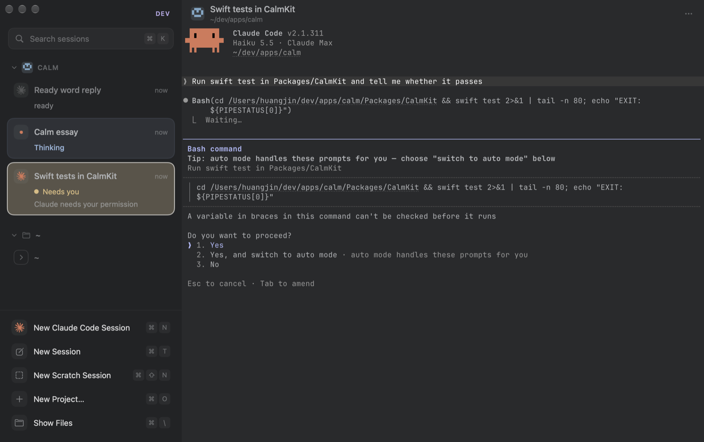

<!-- what-we-build: drafted 2026-10-28 -->


# Calm Terminal

> A minimal macOS terminal that keeps you calm and focused.

[](https://github.com/jinhuang712/calm/actions/workflows/ci.yml)
[](LICENSE)




Calm is a terminal for days spent supervising CLI coding agents such as Claude Code, Codex, OpenCode and pi. It interrupts you for one thing only: an agent that needs you. Calm stays a terminal, so the agents keep their own interfaces.

> **Note**
> Version [0.1.4](CHANGELOG.md), a public preview. Only the author has used it, since 2026-09-29, so expect rough edges.

## 🔔 One look tells you who needs you

The sidebar above shows three real Claude Code sessions: one has finished, one is thinking, and one wants to run a command. Only *needs you* sends a notification, at the next natural pause. **⌘⇧A** jumps to the session that has waited longest.

## 🧭 Resume, restart or fork any session


Quit Calm and every shell, split and running agent comes back. Restart an agent on its conversation, fork it, or copy its resume command. **⌘K** searches the history of every agent, even after an agent deletes its transcripts.

## 📖 Read what the agent wrote, right there


Open the Markdown, HTML, PDF, image or diff that an agent produced in a read-only viewer, without leaving Calm. **⌘-click** a path and it opens at its line, **⌥-click** copies one table cell, and **⌘F** finds in a session, even in a full-screen agent.

There is also a command palette (**⌘P**), splits (**⌘⌥ + arrow**), five soft themes and a `calm` command for scripts and agents.

> **Note**
> The pictures are headless screenshots of the development build (Calm Dev, which is why the mark is violet and the sidebar says DEV). The sessions are real Claude Code 2.1.311 with Haiku 5.5 in manual permission mode, and no command was approved. `scripts/readme-shots.sh` makes them again.

## ⌨️ Keys

| To do this | Press |
|---|---|
| Start your agent / a shell / a scratch session | ⌘N / ⌘T / ⌘⇧N |
| Open a project | ⌘O |
| Jump to the session that needs you | ⌘⇧A |
| Search every past conversation | ⌘K |
| Find in this session | ⌘F |
| Show or hide the files column | ⌘\ |
| Run an action that has no key | ⌘P |
| Reopen the session you closed | ⌘⇧T |
| Settings | ⌘, |

Every key is in [UIUX.md](specs/UIUX.md). The `calm` command reaches Calm from a shell: [CLI.md](specs/CLI.md).

## 📦 Install

Calm needs macOS 14.5 or later on Apple silicon.

```sh
curl -fsSL https://raw.githubusercontent.com/jinhuang712/calm/main/get.sh | bash
```

That downloads the newest release, puts Calm in Applications and links the `calm` command into `~/.local/bin`. Homebrew, the disk image, the newest build of `main`, building from source, updating and uninstalling are in [INSTALL.md](INSTALL.md).

## 💡 Good to know

- **Agents need no setup to be seen.** Calm detects them from their process. For exact state, connect them in **Calm → Agents…**. Each connection asks first and can be undone.
- **Calm is a terminal and nothing more.** It has no chat, editor, browser or account. Its own code uses the network once a day, to ask GitHub for the newest release. **Settings → General → Check for updates** turns that off.
- **The first launch asks for permissions once:** notifications, then Documents, Desktop and Downloads.
- **Quitting keeps your shells running.** Close the sessions you want to end first (⌘W).

## 🛟 Reporting a problem

Open an [issue](https://github.com/jinhuang712/calm/issues). **⌘P → Dump Logs** writes a text file with the version, settings and session states. It holds only ids, states and counts, never a folder, a title or a word that anyone wrote. It is safe to attach.

## 📚 Documents

| Document | Answers |
|---|---|
| [PROPOSAL.md](PROPOSAL.md) | Why did we start this? |
| [PHILOSOPHY.md](PHILOSOPHY.md) | Why is it this way? |
| [DESIGNS.md](DESIGNS.md) | How is it built, and why that way? |
| [GOALS.md](GOALS.md) | What do we measure? |
| [FEATURES.md](specs/FEATURES.md) | What does it do, and what will it do? |
| [UIUX.md](specs/UIUX.md) | How does it look and move? |
| [CLI.md](specs/CLI.md) | What does every `calm` command do? |
| [ROADMAP.md](plans/ROADMAP.md) | When, and how far along? |
| [INSTALL.md](INSTALL.md) | How do I install, update and remove it? |
| [RUNBOOK.md](RUNBOOK.md) | How do I build, release and install it? |
| [TODO.md](plans/TODO.md) | What is still open? |
| [CHANGELOG.md](CHANGELOG.md) | What changed in each release? |
| [AGENTS.md](AGENTS.md) | How do coding agents work in this repository? |

## 📄 License

[Apache-2.0](LICENSE). See [NOTICE](NOTICE) for third-party attributions. Calm's terminal engine is libghostty from [Ghostty](https://github.com/ghostty-org/ghostty).
